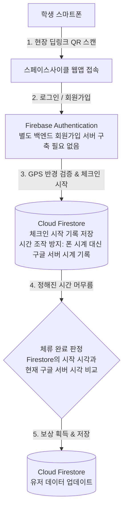

# Space Cycle

> 모바일 웹앱 개발 중입니다. 내부·외부 각 5개 항목과 공통 메뉴, 공간 상세 펼침, 카메라 QR 스캔을 제공합니다. **내부 공간 01은 향설생활관2 테스트 장소**이며, QR → 위치 권한 → 반경 100m 안에서 연속 1분 머무르기를 시험할 수 있습니다. 나머지 9개 공간과 모든 공간 사진은 준비 중입니다. 테스트 완료는 뱃지·보상/방문 기록을 저장하지 않습니다. 아래 핵심 기능과 Firestore 흐름도는 최종 개발 목표이며, 현재 테스트는 Express 서버 메모리에서 시간을 판정합니다. 소스 구현과 운영 사이트 배포 여부는 별도로 확인해야 합니다.
>
> 로컬 실행·Docker 배포·Cloudflare Tunnel 연결: [DEPLOYMENT.md](DEPLOYMENT.md)

## 1. 개발 배경 (Motivation)

대학교 캠퍼스에는 잘 알려지지 않아 잘 사용되지 않는 '유휴 공간'들이 존재합니다.
Space Cycle은 학생들의 이러한 공간을 직접 찾아가 머물도록 유도하여 캠퍼스 공간의 활동도를 높이고 재발견을 돕는 위치 기반 게이미피케이션(Gamification) 웹앱입니다.

---

## 2. 핵심 기능 (Key Features)

- 흑백 < -- > 컬러 공간 도감 (My Page) : 미방문 공간은 흑백 처리, 방문 인증 완료 시 컬러로 해금되어 수집욕 자극.
- 체류 기반 마스코트 스티커 보상 : 단순 방문이 아닌 일정 시간을 체류하면 해당 장소의 고유 마스코트 스티커 발급 및 My Page에 저장.
- 공간 스토리 : 체류 시간을 보내는 동안 해당 공간의 이야기를 보여줌.

---

## 3. 기술적 의사결정(Engineering Decisions)
- Q. 단순 QR 스캔 VS 딥링크(Deep Link) QR 스캔 : 
  - 기본 스마트폰 카메라로 장소별 HTTPS 딥링크를 여는 방식을 지원하고, 웹앱에서 이미 공간을 찾고 있는 사용자에게는 선택형 카메라 스캐너도 제공합니다.
  - 인쇄 QR은 `https://spacecycle.space/s/in01`~`in05`, `https://spacecycle.space/s/out01`~`out05`입니다. 내부 ID `indoor-01`~`indoor-05`, `outdoor-01`~`outdoor-05`와 매핑합니다. `in01`은 `/visit?space=indoor-01`로, 나머지는 등록 예정 공간 정보로 연결합니다. 기존 `/spaces?space=indoor-01` 형식도 스캐너에서 인식합니다. 기존 주소를 기본 카메라로 열면 공간 정보가 표시됩니다.
  - 웹앱 스캐너는 사용자가 시작 버튼을 누를 때 카메라 권한을 요청합니다. 영상은 기기 내에서 처리하며 마이크·녹화·서버 업로드는 사용하지 않습니다. QR 인식, 중단, 화면 이탈 시 카메라를 해제합니다.
  - 외부 주소·잘못된 공간·선택한 공간과 다른 QR은 이동시키지 않습니다. 정상 QR도 결과 확인 후 사용자가 버튼을 눌러 이동하며, 테스트 장소는 위치·체류 화면으로 연결됩니다. QR 읽기만으로 방문 인증이나 보상을 지급하지 않습니다.

- Q. 부정 인증 방식 : 
  - QR은 장소 식별용입니다. 정적 QR의 복사본이나 URL 직접 접속은 구분하지 못합니다. 테스트는 GPS 반경 확인을 추가하지만 브라우저가 보고한 좌표의 조작까지 방지하지 못하므로 부정행위 방지 인증으로 간주하지 않습니다.
  - 테스트 체류 시간은 휴대폰 시각/타이머가 아닌 Express 서버의 단조 증가 시간(`performance.now`)으로 계산합니다. 샘플 사이 실제 이동은 관측하지 못합니다. 로그인/사용자별 검증/Firestore 보상 저장은 별도 구현이 필요합니다.

### 향설생활관2 체류 테스트

설정 원본: `public/js/space-data.js`.

| 항목 | 값 |
|---|---|
| ID / 인쇄 코드 | `indoor-01` / `in01` |
| 위도 | `36.7678561856971` |
| 경도 | `126.933492079991` |
| 반경 / 연속 체류 | **100m / 60초** |
| 인정 조건 | 보고된 정확도 ≤ 50m, 중심점 거리 + 정확도 ≤ 100m |

- 위치 권한은 버튼 클릭 후 요청합니다. `getCurrentPosition`으로 약 3초마다 새 위치를 요청하고 `enableHighAccuracy: true`, `maximumAge: 0`, 6초 위치 timeout을 사용합니다. 마지막 좌표를 반복 전송하지 않습니다.
- 서버는 순차 일회용 challenge를 검증하고 거리·정확도·연속 시간만 상태에 유지합니다. 원본 좌표 기록을 DB/앱 로그에 남기지 않습니다. API 본문/디버그 로그를 운영 프록시에서 별도로 기록하지 마세요.
- 이탈/정확도 부족은 0초로 초기화하고 올바른 다음 위치에서 자동 재시작합니다. 위치 오류/네트워크 실패/12초 넘는 갱신 중단은 초기화합니다. 서버 샘플 간격이 12초를 넘으면 다음 정상 샘플도 0초부터 시작합니다.
- 화면 숨김·페이지 이탈·새로고침·오프라인·수동 중단은 초기화하고 수동으로 다시 시작합니다. 위치 권한 팝업 대기 상한은 30초입니다. 브라우저가 이미 요청한 1회 GPS 측정은 취소 API가 없어 늦게 도착해도 무시하며 추가 요청은 하지 않습니다.
- 화면의 남은 시간은 **서버가 확인한 값만** 표시하므로 약 3초 단위로 갱신됩니다. 서버가 60초 이상 확인하기 전에는 완료로 표시하지 않습니다.
- 서버 메모리만 사용하는 단일 프로세스 테스트입니다. 세션은 생성 후 10분 만료, 동시 최대 500개입니다. 재시작 시 소멸하며 다중 인스턴스/다중 worker/보상 서비스에는 그대로 사용하면 안 됩니다. origin 검사와 challenge는 로그인이나 GPS 위변조 방지 수단이 아닙니다.
- 휴대폰 기본 카메라 → `/s/in01` 또는 웹앱 스캐너 → 결과 버튼 → 위치 권한 허용 → 반경 내 1분 → 테스트 완료. 실물 QR과 실제 iOS/Android GPS·권한 동작은 배포 후 현장에서 별도 확인합니다.

- Q. HTTPS 필요성 : 
  - 모바일 웹 환경에서 카메라, GPS 보안 정책을 충족하기 위해 SSL/TSL 인증서 기반 HTTPS 환경을 필수로 구성해야함.

- Q. DB 및 사용자 검증 : 
  - Google FireBase를 이용하여 학생들의 접근성을 높여 불편한 로그인 과정을 구글 원클릭 로그인으로 대체.
  - 별도의 무거운 DB를 서버에 설치해 이용하지 않고 클라우드 DB의 강점을 활용.

---

## 4. 시스템 흐름도 (System Flowchart)

