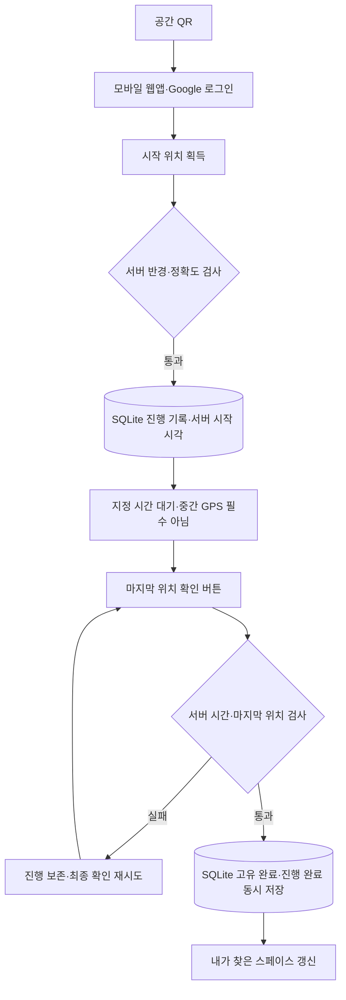

# Space Cycle

> 모바일 캠퍼스 공간 탐색 웹앱입니다. 내부·외부 각 5개 공간 목록, 공통 메뉴, 공간 상세 펼침, 카메라 QR 스캔을 제공합니다. **내부 공간 01(향설생활관2)과 외부 공간 01~05가 테스트 장소**이며 **QR → Google 로그인 → 시작 위치 확인 → 장소별 지정 시간 대기 → 마지막 위치 확인 → 계정별 완료 저장** 흐름을 사용합니다. 같은 공간은 한 번만 ‘내가 찾은 스페이스’에 집계합니다. 나머지 내부 공간 4곳과 내부 공간 사진은 준비 중이며 뱃지·스티커 보상은 아직 없습니다.
>
> 진행 기록과 완료 기록은 모두 SQLite 영구 볼륨을 사용합니다. **시작·종료 때 보고된 위치와 그 사이 시간만 확인하며, 중간에 계속 현장에 있었음을 인증하지 않습니다.** 실제 휴대폰 위치 획득 성공은 기기·브라우저·현장 환경에 따라 다릅니다.
>
> 실행·운영: [DEPLOYMENT.md](DEPLOYMENT.md)

## 개발 배경

대학교 캠퍼스의 잘 알려지지 않거나 잘 쓰이지 않는 공간을 학생들이 직접 찾아가 탐색하고, 계정별 공간 도감에 모으도록 돕는 팀 프로젝트입니다.

## 현재 기능과 범위

- 최대 480px 단일 열 모바일 레이아웃, 크림·남색의 라이트·다크 테마.
- 공통 메뉴 **Home / 공간 / QR 찍기 / 뱃지 보기**와 내부·외부 각 5개 항목.
- 번호 행을 펼치면 사진·특징·QR 이동. 미등록 정보와 사진은 준비 중으로 표시.
- Firebase Google 로그인, 서버 ID 토큰 서명 검증, 계정별 고유 완료 개수.
- `in01` 향설생활관2와 `out01`~`out05` 외부 공간의 시작·종료 위치 검증. 내부 02~05는 설정 준비 중.
- 실제 뱃지·스티커 지급, Firestore 보상·도감 컬러 해금은 미구현.

## QR·카메라

- 인쇄 QR은 `https://spacecycle.space/s/in01`~`in05`, `https://spacecycle.space/s/out01`~`out05`의 고정 HTTPS 주소입니다. 내부 ID `indoor-01`~`indoor-05`, `outdoor-01`~`outdoor-05`에 매핑합니다.
- `in01`, `out01`~`out05`는 `/visit?space=…` 체류 화면, 나머지는 준비 중인 공간 정보로 연결합니다. 기존 `/spaces?space=indoor-01` 형식도 스캐너에서 인식합니다.
- 기본 휴대폰 카메라 또는 앱의 선택형 스캐너를 사용합니다. 스캐너는 명시적 시작 후 후면 카메라 우선, 마이크·녹화·업로드 없이 기기 내에서 해독합니다. 결과·취소·화면 이탈·백그라운드에서 카메라를 해제합니다.
- 허용되지 않은 출처·잘못된 공간·선택 공간과 다른 QR은 이동시키지 않습니다. QR을 읽는 것만으로 방문이나 완료를 저장하지 않습니다.
- **정적 QR 복사나 URL 직접 접속은 구분할 수 없습니다.** QR은 공간 식별 수단이지 실제 방문 증명서가 아닙니다.

## 시작·종료 검증

설정 원본: `public/js/space-data.js`. 필요 시간은 클라이언트 요청값이 아니라 서버 공간 설정에서 결정합니다.

| 항목 | 현재 테스트 값 |
|---|---|
| ID / 인쇄 코드 | `indoor-01` / `in01` |
| 장소 | 향설생활관2 |
| 위도 | `36.767780` |
| 경도 | `126.933294` |
| 반경 / 지정 시간 | **100m / 60초** |
| 위치 인정 | 보고된 정확도 ≤50m, 중심점 거리 + 정확도 ≤100m |
| 위치 요청 | 시작·마지막 확인 버튼에서만 요청, 고정밀·`maximumAge: 0`. 정확도가 50m보다 나쁘면 예산 안에서 계속 재측정하고, 시간이 다 되면 가장 정확했던 값을 보냄 |
| 획득 예산 | 1회 최대15초, 한 번의 버튼 작업 전체 최대30초 |
| 진행 유효기간 | 시작 후 최대2시간 |

### 외부 공간 (테스트, 반경 100m · 정확도 ≤50m · 1분)

모든 공간은 반경 100m입니다. 공간끼리 최소 약 199m 떨어져 있고 ‘거리 + 정확도 ≤100m’일 때만 인정하므로, 현실적인 위치 하나가 두 공간에 동시에 인정되지 않습니다. 사진은 `public/images/spaces/`에 웹용으로 줄이고 촬영 위치 등 EXIF 메타데이터를 제거해 넣었습니다.

| 코드 | 장소 | 위도 | 경도 |
|---|---|---|---|
| `out01` | 학예관·멀티미디어관 앞 야외 광장 | `36.76947221339854` | `126.93489279497715` |
| `out02` | SCH미디어랩스관 뒤편 벤치 | `36.771923550939704` | `126.93141557699708` |
| `out03` | 소운동장·체육관 사이 정자 | `36.770186150125774` | `126.93055745846503` |
| `out04` | 산학협력관–학성사 연결길 | `36.77109369711564` | `126.93393653938706` |
| `out05` | 대운동장 정면 길 | `36.76898666399184` | `126.92886443646337` |

### 정상 흐름

1. QR로 장소를 선택하고 Google 로그인합니다.
2. ‘위치 확인하고 시작’을 누릅니다. 브라우저에서 새 위치를 받고, 서버가 반경·정확도를 통과시켜야 시작 시각·필요 시간·만료 시각을 SQLite에 저장합니다. 첫 위치를 기다리는 동안은 대기 시간으로 세지 않습니다.
3. 지정 시간 동안 **GPS 재측정이나 주기적인 API 요청은 하지 않습니다.** 휴대폰의 남은 시간은 마지막 서버 응답의 경과값과 `performance.now()`로 표시할 뿐, 완료 권한은 없습니다.
4. 표시가 00:00이 되면 ‘마지막 위치 확인’을 직접 누릅니다. 새 위치를 받아 서버가 시간·위치를 모두 검사합니다.
5. 서버가 완료 기록과 진행 완료 상태를 함께 저장한 경우에만 완료·카운트 증가를 표시합니다.

### 오류·복구 정책

- 처음 위치를 못 받거나 반경·정확도 조건을 못 맞추면 시작하지 않습니다.
- 마지막 위치 시간초과·권한 오류·정확도 부족·범위 밖·통신 오류는 **기다린 시간을 초기화하지 않습니다.** 유효기간 안에 마지막 확인을 다시 할 수 있으며, 오류 상태를 완료로 저장하지 않습니다.
- 새로고침·화면 잠금·백그라운드·오프라인은 서버 진행을 지우지 않습니다. 같은 계정으로 장소 화면에 돌아오면 복구하며, 복구만으로 위치 권한을 자동 요청하지 않습니다.
- 계정 변경·페이지 이탈 중 늦게 도착한 GPS/API 응답은 무시합니다. 계정 변경은 이전 계정의 진행을 삭제하지 않습니다.
- **명시적 ‘중단하고 초기화’ 또는 유효기간 만료**가 진행을 종료합니다. 이미 얻은 고유 완료 기록은 취소로 지우지 않습니다.
- 처음 요청의 응답이 끊겼어도 계정·공간별 시작이 중복 생성되지 않으며 복구 요청으로 확인합니다. 완료 응답 유실·재시도·동시 완료도 중복 집계하지 않습니다.
- 브라우저는 시작마다 암호학적 난수 `attemptId`를 보냅니다. 시작 응답을 아직 받지 못한 상태에서 취소하면 서버가 해당 시도의 취소 의도를 먼저 영구 저장합니다. 취소가 시작 요청을 추월해도 늦은 시작은 `start_cancelled`로 거절되며, 단순 복구의 idle 응답을 취소 증거로 삼지 않습니다. 취소 응답이 유실되면 확인필요 상태로 남아 같은 시도의 취소를 다시 확인합니다. 취소 의도 표는 계정·시도 ID·공간·매핑된 진행 ID·취소 여부·만료 시각만 저장하며 원본 GPS는 저장하지 않습니다.
- 측정 시각이 유효하지 않거나 10초 초과 과거·3초 초과 미래·직전 이하 timestamp이면 해당 위치를 보내지 않고 획득 예산 안에서 새 위치를 요청합니다. 같은 좌표라도 새 측정 시각이면 정상입니다. timestamp를 새 것으로 조작하거나 시작 좌표를 마지막 위치로 재사용하지 않습니다.
- 오류는 로그인·위치·통신·보안 응답·저장 실패 등 안전한 코드로 구분합니다. 화면 진단은 측정값 나이·요청 소요·허용 코드만 기기 내 표시하며 원본 좌표·토큰·절대 측정 시각은 진단 기록으로 저장하지 않습니다.

### 검증의 한계

**시작과 끝 사이 중간 이탈 후 복귀는 구분하지 못합니다.** 기존의 짧은 GPS 연속성 기한과 ‘연속 체류 인증’ 요구를 없애 사용성을 선택한 모델입니다. 출석·금전 보상·엄격한 체류 증명이 필요한 서비스의 근거로 사용하지 않습니다. 브라우저 GPS 조작도 완전히 차단하지 못합니다. 위치가 잡히지 않는 단말에서는 마지막 확인이 계속 필요하며, 서버가 GPS를 대신 획득하지 않습니다.

## 서버·저장·요청 제한

- Firebase ID 토큰의 Google 공개키 서명, 발급 프로젝트·audience·만료·제공자를 서버에서 검증합니다. 서버(Docker VM 등)와 Google 사이 시계 오차로 갓 발급된 토큰이 거절되지 않도록 ±60초 오차를 허용합니다. 요청의 UID·시간·완료 플래그는 신뢰하지 않습니다.
- 서버 시각으로 시작·준비·만료 시각을 정해 SQLite에 저장합니다. 프로세스 재시작을 넘어 비교하기 위해 서버 `Date.now()`를 사용하므로 운영 호스트의 NTP/시각 관리를 유지해야 합니다. 휴대폰 시각을 바꿔도 서버 대기 시간이 바뀌지 않습니다.
- `visits`의 `(uid, space_id)` 기본키는 그대로 보존합니다. 진행 표는 별도 추가하며 진행 완료와 고유 완료 삽입을 원자적으로 처리합니다. 원본 좌표·정확도·이메일·로그인 토큰은 DB에 저장하지 않습니다.
- 진행 기록은 계정·공간당 하나이며 **미완료(active) 진행은 최대10,000개**입니다. 완료 상태의 진행 행은 이 한도에서 제외하며 유효기간 만료 시 함께 정리합니다. 계정별 API 요청은 분당60회로 제한하고, 제한기 상태도 유한하게 관리합니다. 이 제한값은 실측 처리량 보장이 아닙니다.
- 기다리는 사용자마다 서버 타이머나 연결을 유지하지 않습니다. 시작·복구·완료 등 요청 시점에만 검증/DB 작업을 합니다. 복수 서버/worker를 추가할 때는 SQLite 쓰기 경합과 프로세스별 제한기 범위를 다시 설계해야 합니다.
- 홈 숫자는 인증된 `GET /api/me/spaces`를 사용합니다. 조회 실패를 0으로 숨기지 않습니다. 기존 Firestore 값과 저장 도입 전 테스트는 소급 집계하지 않습니다.
- 관리자 비밀키 없이 `jose`와 Google securetoken 공개 JWKS를 사용합니다. Firebase 계정 비활성화·토큰 강제 철회까지 관리자 API로 조회하는 것은 아닙니다.

## API 계약

모든 `/api/stays` 동작은 검증된 Bearer 토큰, 허용된 Origin, JSON(최대2KB)이 필요하며 응답은 `no-store`입니다.

| POST 경로 | 정확한 본문 | 역할 |
|---|---|---|
| `/api/stays` | `{spaceId, latitude, longitude, accuracy, attemptId}` | 시작 위치 검사·계정별 중복 없는 시작 |
| `/api/stays/resume` | `{spaceId}` | 진행·완료 복구 또는 idle |
| `/api/stays/abandon` | `{spaceId, attemptId}` | 미확인 시작 시도의 취소 의도 영구 저장 후204 |
| `/api/stays/:id/finish` | `{challenge, latitude, longitude, accuracy}` | 서버 시간·마지막 위치 검사·원자적 완료 |
| `/api/stays/:id/cancel` | `{challenge}` | 해당 계정 진행 취소 |

브라우저 `attemptId`는 새 시작마다 보안 난수로 생성한 소문자16진수48자리입니다. 취소 의도/시도 매핑은 최대10,000행·2시간 만료이며, 살아 있는 취소 기록을 한도 초과 때문에 밀어내지 않습니다. 호환용으로 서버가 `attemptId` 없는 기존4필드 시작을 허용하지만 미확인 시작 취소의 순서 보장은 이 경로에 적용되지 않으며 현재 브라우저는 항상 시도 ID를 보냅니다.

기존 `/api/stays/:id/sample` 연속 표본 API는 공개 흐름에서 제거했습니다. 구버전 화면을 열어두었다면 새로고침해야 합니다. 기존 인쇄 QR 주소와 고유 완료 기록은 유지합니다.

## 실행과 검증

```bash
npm ci
npm test
npm start
```

Node 24의 SQLite를 사용합니다. 자동 검사는 서명·소유권·중복·저장 실패·복구·GPS 지연·동시 요청·화면 상태 등을 격리된 DB와 합성 센서로 검증합니다. **실제 Android/iOS GPS·카메라·개인 Google 로그인 성공은 별도의 현장 확인**입니다. 로컬 CSS는 HTML에 포함하고 모든 로컬 JS는 내용 해시 버전으로 제공해 캐시 혼합을 줄입니다.

## 현재 시스템 흐름


