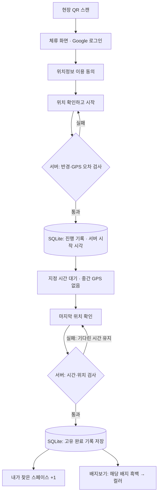

# Space Cycle

> 캠퍼스의 잘 알려지지 않은 유휴 공간을 직접 찾아가 머물면, 그 공간의 마스코트 배지가 흑백에서 컬러로 바뀌는 **위치 기반 게이미피케이션 모바일 웹앱**입니다.
>
> 서비스 주소: **https://spacecycle.space** · 실행·운영 방법: [DEPLOYMENT.md](DEPLOYMENT.md)

## 1. 개발 배경

대학교 캠퍼스에는 잘 알려지지 않아 거의 쓰이지 않는 '유휴 공간'이 있습니다. Space Cycle은 학생들이 이런 공간을 직접 찾아가 일정 시간 머물도록 유도해, 캠퍼스 공간의 활용도를 높이고 공간을 다시 발견하도록 돕는 팀 프로젝트입니다.

## 2. 핵심 기능

| 기능 | 설명 |
|---|---|
| **QR로 바로 시작** | 현장에 붙은 QR을 휴대폰 기본 카메라로 찍으면 해당 공간의 체류 화면이 바로 열립니다. 앱 안의 QR 스캐너도 제공합니다. |
| **위치 + 체류 시간 인증** | Google 로그인 후 '위치 확인하고 시작' → 지정 시간 대기 → '마지막 위치 확인'. 시작과 끝 위치가 공간 반경 안이고, 서버 시계 기준으로 시간이 지나야 완료됩니다. |
| **흑백 → 컬러 배지 도감** | 배지보기에서 아직 가지 않은 공간의 배지는 흑백, 체류를 완료한 공간의 배지는 컬러로 표시됩니다. |
| **내가 찾은 스페이스** | 계정별로 완료한 공간 수를 홈에 표시합니다. 같은 공간은 여러 번 완료해도 한 번만 셉니다. |
| **공간 둘러보기** | 내부·외부 각 5개 공간의 사진, 위치, 특징, 인증 조건을 펼쳐 볼 수 있습니다. |
| **개인정보 보호** | 개인정보 처리방침(`/privacy`)을 공개하고, 위치를 확인하기 전에 화면에서 위치정보 이용 동의를 받습니다. 원본 좌표는 저장하지 않습니다. |

최대 480px 단일 열 모바일 레이아웃이며 라이트·다크 테마를 지원합니다. 하단 메뉴는 **Home / 공간 / QR찍기 / 배지보기**입니다.

## 3. 현재 등록된 공간

설정 원본은 `public/js/space-data.js`입니다. 반경·정확도·체류 시간은 서버가 이 설정으로 판정하며, 클라이언트가 보낸 값을 믿지 않습니다.

| 코드 | 장소 | 반경 | GPS 오차 기준 | 체류 시간 |
|---|---|---|---|---|
| `in01` | 향설생활관2 (기능 테스트용) | 100m | ≤50m | 1분 |
| `out01` | 학예관·멀티미디어관 앞 야외 광장 | 40m | ≤20m | 1분 |
| `out02` | SCH미디어랩스관 뒤편 벤치 | 20m | ≤20m | 1분 |
| `out03` | 소운동장·체육관 사이 정자 | 15m | ≤20m | 1분 |
| `out04` | 산학협력관–학성사 연결길 | 35m | ≤20m | 1분 |
| `out05` | 대운동장 정면 길 | 55m | ≤20m | 1분 |

- 외부 공간 반경은 현장 테스트 후 공간별로 정했습니다. 공간끼리 최소 약 199m 떨어져 있어 한 위치가 두 공간에 동시에 인정되지 않습니다.
- 체류 시간 1분은 현장 검증용 테스트 값입니다.
- 내부 공간 02~05는 장소 선정 중이며, 사진·배지도 준비 중입니다.
- 공간 사진(`public/images/spaces/`)은 웹용으로 줄이고 촬영 위치 등 EXIF 메타데이터를 제거했습니다. 배지 이미지는 `public/images/badges/`에 있습니다.

## 4. 기술적 의사결정

**Q. 앱 스캐너 vs 딥링크 QR**
기본 카메라로 찍으면 바로 체류 화면으로 이동하는 고정 HTTPS 주소(`https://spacecycle.space/s/out01` 등)를 QR에 담았습니다. 웹앱을 열고 스캐너를 켜는 단계를 없애기 위해서입니다. 주소는 바꾸지 않으므로 인쇄한 QR은 계속 쓸 수 있습니다.

**Q. 부정 인증은 어떻게 막나**
- QR만 찍어서는 완료되지 않습니다. QR은 공간을 고르는 수단이고, 인증은 GPS 반경 검증과 체류 시간 검증을 함께 통과해야 합니다.
- 체류 시간은 **서버 시계**로만 판정합니다. 휴대폰 시계를 바꿔도 대기 시간이 줄지 않습니다.
- GPS 오차가 기준보다 큰 측정값은 거절합니다. 앱은 정확한 값이 나올 때까지 최대 30초 동안 다시 측정하고, 시간이 다 되면 가장 정확했던 값을 보냅니다.

**Q. 인증 규칙: '거리 + 오차 ≤ 반경' 대신 '거리 ≤ 반경, 오차 ≤ 기준'**
처음에는 GPS 오차 원 전체가 반경 안에 들어와야 인정했습니다. 하지만 휴대폰 GPS 오차는 야외에서도 5~15m라서, 15~20m처럼 작은 반경에서는 중심에 서 있어도 실패할 수 있었습니다. 그래서 측정 위치가 반경 안이면 인정하고, 오차는 따로 상한을 두는 방식으로 바꿨습니다.

**Q. 중간에 계속 GPS를 확인할까**
처음에는 체류 중 몇 초마다 위치를 다시 확인하는 연속 인증을 만들었습니다. 그런데 실제 휴대폰에서는 화면 잠금, 백그라운드 전환, 실내 GPS 끊김 때문에 진행이 자주 풀렸습니다. 그래서 **시작과 끝 위치만 확인**하는 방식으로 바꿔 사용성을 택했습니다. 대신 중간에 자리를 떠났다 돌아오는 것은 구분하지 못합니다(아래 '한계' 참고).

**Q. DB: Cloud Firestore → 서버 SQLite**
처음 계획은 Firestore에 체크인 기록을 저장하는 것이었습니다. 하지만 체류 판정을 서버 시계로 하고 완료 기록의 중복 방지·원자적 저장을 확실히 하려면, 판정과 저장이 같은 서버 안에서 일어나는 편이 단순하고 안전했습니다. 그래서 직접 운영하는 서버의 SQLite(Node 24 내장)로 바꿨습니다. 로그인은 계획대로 Firebase Google 로그인을 쓰고, 서버는 Firebase ID 토큰의 서명만 검증합니다(관리자 비밀키 불필요).

**Q. 도감과 스티커**
처음에는 '흑백↔컬러 공간 도감'과 '마스코트 스티커 보상'을 따로 계획했습니다. 같은 경험을 두 번 보여주는 셈이라, 마스코트가 그려진 **배지 하나로 통합**했습니다. 체류 중 공간 이야기를 보여주는 '공간 스토리' 기능도 계획했지만, 앱이 과해진다고 판단해 범위에서 뺐습니다.

**Q. HTTPS**
모바일 브라우저는 HTTPS에서만 카메라와 GPS를 허용합니다. Cloudflare Tunnel로 `https://spacecycle.space`를 서비스하고, 서버 포트는 외부에 열지 않습니다.

## 5. 시스템 흐름



## 6. 체류 인증 상세

### 정상 흐름

1. QR로 공간을 열고 Google 로그인합니다.
2. 위치정보 이용에 동의하고 '위치 확인하고 시작'을 누릅니다. 서버가 반경·GPS 오차를 통과시키면 시작 시각·필요 시간·만료 시각을 저장합니다. 첫 위치를 기다리는 시간은 대기 시간에 넣지 않습니다.
3. 대기 중에는 **GPS를 다시 재지 않고 서버에 주기적으로 요청하지도 않습니다.** 화면의 남은 시간은 표시용일 뿐 완료 권한이 없습니다.
4. 00:00이 되면 '마지막 위치 확인'을 직접 누릅니다. 서버가 시간과 위치를 모두 검사합니다.
5. 서버가 완료 기록을 저장한 뒤에만 완료와 개수 증가를 표시합니다.

### 위치 측정

| 항목 | 값 |
|---|---|
| 위치 요청 시점 | 시작·마지막 확인 버튼을 누를 때만 (고정밀, `maximumAge: 0`) |
| 측정 시간 | 1회 최대 15초, 버튼 한 번에 최대 30초 |
| 측정값 신선도 | 10초보다 오래됐거나 3초 이상 미래 시각인 측정값은 버리고 다시 측정 |
| 진행 유효기간 | 시작 후 최대 2시간 |

### 오류·복구

- 시작 위치가 조건을 못 맞추면 시작하지 않습니다.
- 마지막 위치 확인이 실패해도(시간 초과, 권한 거부, 오차 초과, 범위 밖, 통신 오류) **기다린 시간은 유지**되고, 유효기간 안에 다시 확인할 수 있습니다.
- 새로고침·화면 잠금·백그라운드·오프라인에도 서버 진행은 지워지지 않습니다. 같은 계정으로 돌아오면 위치 권한 요청 없이 진행을 불러옵니다.
- '진행 취소'를 누르거나 유효기간이 지나야 진행이 끝납니다. 이미 저장된 완료 기록은 취소해도 지워지지 않습니다.
- 응답 유실·재시도·동시 요청이 있어도 시작과 완료가 중복 생성·중복 집계되지 않습니다. 시작 응답을 받기 전에 취소해도, 늦게 도착한 시작 요청은 서버가 거절합니다(`attemptId` 기반).
- 오류는 로그인·위치·통신·저장 실패 등 코드로 구분해 화면에 안내합니다.

### 한계

- **시작과 끝 사이에 자리를 떠났다 돌아오는 것은 구분하지 못합니다.**
- QR 사진 복사나 URL 직접 접속은 막지 못합니다. 대신 위치 검증을 통과해야 합니다.
- 브라우저 GPS 위조를 완전히 막지는 못합니다. 출석 확인이나 금전 보상처럼 엄격한 증명이 필요한 용도에는 쓰지 않습니다.

## 7. 서버·저장·개인정보

- **로그인 검증**: Firebase ID 토큰의 Google 공개키 서명, 프로젝트, 만료, 로그인 제공자를 매 요청 검증합니다. 서버와 Google의 시계 차이로 갓 발급된 토큰이 거절되지 않도록 ±60초를 허용합니다.
- **저장 내용**: 계정 UID, 공간 ID, 시작·완료 시각만 저장합니다. 원본 좌표, GPS 오차, 이메일, 이름, 토큰은 저장하지 않습니다.
- **요청 제한**: 계정당 API 분당 60회, 진행 중 기록 최대 10,000개.
- **시각**: 대기 시간 판정에 서버 시각을 쓰므로 서버의 시간 동기화(NTP)를 유지해야 합니다.
- **개인정보 처리방침**: `/privacy`. 처리 항목, 위치정보 이용, 보관 기간, 국외 이전(Firebase·Cloudflare), 삭제 요청 방법을 안내합니다. 위치 확인 전에 체류 화면에서 동의 체크를 받습니다.

### API

모든 `/api/stays` 요청은 Bearer 토큰, 허용된 Origin, JSON 본문(최대 2KB)이 필요합니다.

| 경로 | 본문 | 역할 |
|---|---|---|
| `POST /api/stays` | `{spaceId, latitude, longitude, accuracy, attemptId}` | 시작 위치 검사·진행 시작 |
| `POST /api/stays/resume` | `{spaceId}` | 진행 상황 복구 |
| `POST /api/stays/abandon` | `{spaceId, attemptId}` | 응답 전 시작 요청 취소 |
| `POST /api/stays/:id/finish` | `{challenge, latitude, longitude, accuracy}` | 시간·마지막 위치 검사·완료 저장 |
| `POST /api/stays/:id/cancel` | `{challenge}` | 진행 취소 |
| `GET /api/me/spaces` | — | 내가 완료한 공간 목록과 개수 |

## 8. 실행과 테스트

```bash
npm ci
npm test
npm start
```

Node 24가 필요합니다. 자동 테스트는 토큰 검증, 계정 소유권, 중복 방지, 저장 실패, 복구, GPS 지연, 동시 요청, 화면 상태, 배지 표시 등을 격리된 DB와 가짜 센서로 확인합니다. 실제 휴대폰 GPS·카메라·Google 로그인은 현장에서 따로 확인했습니다.
