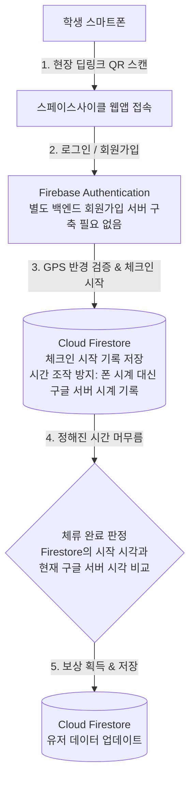

# Space Cycle

> 모바일 웹앱 개발 중입니다. 내부·외부 각 5개 항목과 공통 메뉴, 공간 상세 펼침, 카메라 QR 스캔을 제공합니다. **내부 공간 01은 향설생활관2 테스트 장소**이며, QR → Google 로그인 → 위치 권한 → 반경 100m 안에서 연속 1분 머무르기를 시험할 수 있습니다. 완료한 공간은 **계정별로 한 번만 ‘내가 찾은 스페이스’에 저장**하며 재방문은 중복 집계하지 않습니다. 나머지 9개 공간과 모든 공간 사진은 준비 중이고 뱃지·스티커 보상은 아직 없습니다. 현재 체류 판정은 Express 서버 메모리, 완료 기록은 영구 SQLite 볼륨을 사용합니다. 아래 Firestore 흐름도는 향후 목표이며 현재 저장 방식과 다릅니다. 소스 구현과 운영 사이트 배포 여부는 별도로 확인해야 합니다.
>
> 로컬 실행·Docker 배포·Cloudflare Tunnel 연결: [DEPLOYMENT.md](DEPLOYMENT.md)

## 1. 개발 배경 (Motivation)

대학교 캠퍼스에는 잘 알려지지 않아 잘 사용되지 않는 '유휴 공간'들이 존재합니다.
Space Cycle은 학생들의 이러한 공간을 직접 찾아가 머물도록 유도하여 캠퍼스 공간의 활동도를 높이고 재발견을 돕는 위치 기반 게이미피케이션(Gamification) 웹앱입니다.

---

## 2. 핵심 기능 (Key Features)

- 흑백 < -- > 컬러 공간 도감 (My Page) : 미방문 공간은 흑백 처리, 방문 인증 완료 시 컬러로 해금되어 수집욕 자극.
- 체류 기반 마스코트 스티커 보상 : 단순 방문이 아닌 일정 시간을 체류하면 해당 장소의 고유 마스코트 스티커 발급 및 My Page에 저장.
- 공간 스토리 : 체류 시간을 보내는 동안 해당 공간의 이야기를 보여줌.

---

## 3. 기술적 의사결정(Engineering Decisions)
- Q. 단순 QR 스캔 VS 딥링크(Deep Link) QR 스캔 : 
  - 기본 스마트폰 카메라로 장소별 HTTPS 딥링크를 여는 방식을 지원하고, 웹앱에서 이미 공간을 찾고 있는 사용자에게는 선택형 카메라 스캐너도 제공합니다.
  - 인쇄 QR은 `https://spacecycle.space/s/in01`~`in05`, `https://spacecycle.space/s/out01`~`out05`입니다. 내부 ID `indoor-01`~`indoor-05`, `outdoor-01`~`outdoor-05`와 매핑합니다. `in01`은 `/visit?space=indoor-01`로, 나머지는 등록 예정 공간 정보로 연결합니다. 기존 `/spaces?space=indoor-01` 형식도 스캐너에서 인식합니다. 기존 주소를 기본 카메라로 열면 공간 정보가 표시됩니다.
  - 웹앱 스캐너는 사용자가 시작 버튼을 누를 때 카메라 권한을 요청합니다. 영상은 기기 내에서 처리하며 마이크·녹화·서버 업로드는 사용하지 않습니다. QR 인식, 중단, 화면 이탈 시 카메라를 해제합니다.
  - 외부 주소·잘못된 공간·선택한 공간과 다른 QR은 이동시키지 않습니다. 정상 QR도 결과 확인 후 사용자가 버튼을 눌러 이동하며, 테스트 장소는 위치·체류 화면으로 연결됩니다. QR 읽기만으로 방문 인증이나 보상을 지급하지 않습니다.

- Q. 부정 인증 방식 : 
  - QR은 장소 식별용입니다. 정적 QR의 복사본이나 URL 직접 접속은 구분하지 못합니다. 테스트는 GPS 반경 확인을 추가하지만 브라우저가 보고한 좌표의 조작까지 방지하지 못하므로 부정행위 방지 인증으로 간주하지 않습니다.
  - 테스트 체류 시간은 휴대폰 시각/타이머가 아닌 Express 서버의 단조 증가 시간(`performance.now`)으로 계산합니다. Firebase ID 토큰의 서명·발급 프로젝트·만료·Google 로그인 제공자를 서버에서 검증하고 체류 세션을 계정에 묶습니다. 샘플 사이 실제 이동은 관측하지 못하며 Firestore 보상 저장은 별도 구현이 필요합니다.

### 향설생활관2 체류 테스트

설정 원본: `public/js/space-data.js`.

| 항목 | 값 |
|---|---|
| ID / 인쇄 코드 | `indoor-01` / `in01` |
| 위도 | `36.7678561856971` |
| 경도 | `126.933492079991` |
| 반경 / 연속 체류 | **100m / 60초** |
| 인정 조건 | 보고된 정확도 ≤ 50m, 중심점 거리 + 정확도 ≤ 100m |

- 위치 권한은 버튼 클릭 후 요청합니다. `getCurrentPosition`으로 약 3초마다 새 위치를 요청하고 `enableHighAccuracy: true`, `maximumAge: 0`, 6초 위치 timeout을 사용합니다. 마지막 좌표를 반복 전송하지 않습니다.
- 서버는 순차 일회용 challenge를 검증하고 거리·정확도·연속 시간만 상태에 유지합니다. 원본 좌표 기록을 DB/앱 로그에 남기지 않습니다. API 본문/디버그 로그를 운영 프록시에서 별도로 기록하지 마세요.
- 이탈/정확도 부족은 0초로 초기화하고 올바른 다음 위치에서 자동 재시작합니다. 위치 오류/네트워크 실패/12초 넘는 갱신 중단은 초기화합니다. 서버 샘플 간격이 12초를 넘으면 다음 정상 샘플도 0초부터 시작합니다.
- 화면 숨김·페이지 이탈·새로고침·오프라인·수동 중단은 초기화하고 수동으로 다시 시작합니다. 위치 권한 팝업 대기 상한은 30초입니다. 브라우저가 이미 요청한 1회 GPS 측정은 취소 API가 없어 늦게 도착해도 무시하며 추가 요청은 하지 않습니다.
- 화면의 남은 시간은 **서버가 확인한 값만** 표시하므로 약 3초 단위로 갱신됩니다. 서버가 60초 이상 확인하기 전에는 완료로 표시하지 않습니다.
- 로그인/주소/서버 보안/저장 실패는 원인별 오류 코드로 표시합니다. 만료된 로그인은 토큰을 갱신해 1회 재시도합니다. 화면 하단의 버전과 코드를 통해 이전 파일이 섞였는지 확인할 수 있습니다. 로컬 CSS는 HTML에 포함하고 스크립트는 내용 기반 버전 주소로 제공합니다.
- 진행 중 세션은 단일 프로세스 메모리에 유지되며 생성 후 10분 만료, 동시 최대 500개입니다. 진행 중 시간은 재시작 시 소멸합니다. 다중 인스턴스/worker에는 공유 세션 저장소가 필요합니다. origin 검사와 challenge만으로 로그인이나 GPS 위변조를 방지하는 것은 아닙니다.
- 완료 시 SQLite `visits`의 `(uid, space_id)` 기본키로 원자적 중복 방지 저장을 합니다. 계정 ID·공간 ID·최초 완료 시각만 남기며 원본 GPS·이메일·로그인 토큰은 저장하지 않습니다. 같은 계정의 동시 완료·재시도·새로고침·재방문도 같은 공간은 1곳입니다. 새 계정은 별도 집계합니다.
- 홈은 인증된 `GET /api/me/spaces`의 고유 공간 개수를 표시합니다. 클라이언트가 보낸 uid/count/완료 플래그는 인정하지 않습니다. 기록 조회 실패는 0으로 숨기지 않고 ‘—’와 오류 설명을 표시합니다. 기존 Firestore 숫자·배열은 검증된 완료 내역이 아니므로 자동 이관하지 않습니다.
- 휴대폰 기본 카메라 → `/s/in01` 또는 웹앱 스캐너 → 결과 버튼 → Google 로그인(필요시 원래 장소로 복귀) → 위치 허용 → 반경 내 1분 → 고유 공간 저장. 실제 iOS/Android 카메라·GPS·권한 동작은 현장 확인이 필요합니다.

- Q. HTTPS 필요성 : 
  - 모바일 웹 환경에서 카메라, GPS 보안 정책을 충족하기 위해 SSL/TSL 인증서 기반 HTTPS 환경을 필수로 구성해야함.

- Q. DB 및 사용자 검증 : 
  - Google Firebase Authentication의 팝업 로그인을 사용합니다. Firebase 콘솔의 Authentication → Settings → Authorized domains에 `spacecycle.space`를 추가해야 하며 `authDomain`은 기존 `space-cycle-1b705.firebaseapp.com`을 유지합니다. 무조건 redirect 로그인으로 바꾸지 않습니다.
  - 관리자 비밀키 없이 Google 공개키와 `jose`로 Firebase 토큰을 검증합니다. 별도 DB 서버 없이 Node 24의 SQLite로 완료 기록을 저장합니다. Docker `visits-data` 볼륨을 삭제하면 기록이 사라지므로 백업/보존이 필요합니다.
  - 매 요청의 토큰 만료/서명은 검사하지만 Firebase 계정 비활성화·토큰 강제 철회 여부를 관리자 API로 조회하지는 않습니다. 탈퇴·관리자 차단·보상 기능을 운영할 때는 추가 설계가 필요합니다.

---

## 4. 시스템 흐름도 (System Flowchart)

